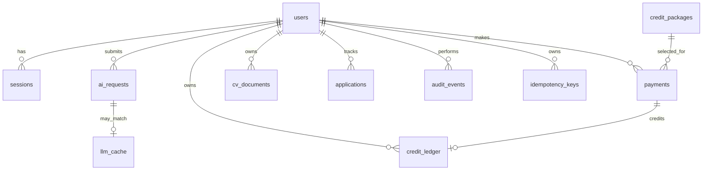

# Career Agency — Database Schema

**Status:** Implementation baseline for the rebuild branch  
**Database targets:** SQLite for local/Termux development; PostgreSQL for production  
**Migration policy:** additive, versioned migrations; no destructive changes to legacy tables until feature/data reconciliation is approved.

## 1. Business rules represented by this schema

- A user row contains an integer `credits` balance, defaulting to zero.
- Every credit movement is also represented in an immutable ledger.
- No monthly subscription or recurring billing is introduced.
- Purchased credits do not expire.
- A credit package is identified by its Naira price and credit quantity. Only the two package endpoints supplied in the latest instruction are confirmed here: ₦500 = 100 credits and ₦200,000 = 120,000 credits. Intermediate package tiers are intentionally not invented; checkout must not publish unapproved packages.
- Base action costs: Chat = 5; CV = 25; Mock Interview = 50; Workspace = 72.
- Cache lookup occurs before a credit debit. A cache hit uses the configured discounted action cost. The example approved for the CV action is 10 credits instead of 25. Other cache-hit prices remain configurable and must be approved before production.
- Paystack credits a wallet only after validating the webhook signature and independently verifying the transaction with Paystack.
- Admin adjustments and refunds require a ledger entry, actor, reason and audit record.

## 2. Entity relationship overview

## 3. Core identity and access tables

### users
- `id` TEXT UUID primary key.
- `email` TEXT unique, normalized lowercase.
- `password_hash` TEXT; Argon2id preferred, scrypt acceptable if Argon2id is unavailable.
- `full_name` TEXT not null.
- `role` TEXT not null; allowed values: `job_seeker`, `employer`, `recruiter`, `admin`.
- `account_status` TEXT not null default `pending_verification`; values: `pending_verification`, `active`, `suspended`, `closed`.
- `email_verified_at` TEXT nullable.
- `credits` INTEGER not null default 0 CHECK (`credits` >= 0).
- `country_code` TEXT default `NG`.
- `created_at`, `updated_at`, `last_login_at` TEXT ISO-8601 UTC timestamps.

The `credits` column is a fast balance projection. The ledger is the financial source of truth. A reconciliation job must compare the projection with ledger totals.

### sessions
Session ID, user ID, hashed refresh token identifier, created/last-seen/expiry/revocation timestamps, device label, IP hash and user-agent summary. Never store raw refresh tokens.

### email_verification_tokens / password_reset_tokens
Store only token hashes, user ID, expiry, used-at and created-at. Tokens are single-use and rate-limited.

### role_permissions
Role, permission key, allowed flag and updated-at. Server-side checks are mandatory; client role values never grant access.

## 4. Credits, packages and payments

### credit_packages
- `id` TEXT primary key.
- `price_kobo` INTEGER not null unique.
- `credits` INTEGER not null.
- `bonus_credits` INTEGER not null default 0.
- `active` INTEGER not null default 0.
- `display_order` INTEGER not null.
- `effective_from`, `effective_until` nullable.
- `created_at`, `updated_at`.

Seed only the confirmed endpoints until the complete package list is approved:
- `price_kobo=50000`, `credits=100`, `active=0` until the full tier schedule is confirmed.
- `price_kobo=20000000`, `credits=120000`, `active=0` until the full tier schedule is confirmed.

The prices above are in kobo: ₦500 × 100 and ₦200,000 × 100. Keeping them inactive prevents a partially specified price catalogue from appearing in live checkout. Admin activation must be audited.

### payments
- `id` TEXT UUID primary key.
- `user_id` TEXT foreign key.
- `package_id` TEXT foreign key.
- `provider` TEXT default `paystack`.
- `reference` TEXT unique not null.
- `amount_kobo` INTEGER not null.
- `currency` TEXT default `NGN`.
- `status` TEXT: `initialized`, `pending`, `success`, `failed`, `reversed`.
- `provider_transaction_id` TEXT nullable unique.
- `verified_at`, `created_at`, `updated_at`.

### credit_ledger
Append-only records: ID, user ID, signed integer `delta`, `balance_after`, `entry_type` (`purchase`, `usage`, `refund`, `admin_adjustment`, `promotion`), reference type/ID, idempotency key, description, actor ID, created-at. Unique idempotency key prevents duplicate charges/credits.

### credit_action_prices
Action key, base cost, cache-hit cost nullable, active flag, version and effective timestamps. Seed:
- `chat`: base 5.
- `cv`: base 25; cache-hit 10 (the supplied example).
- `mock_interview`: base 50.
- `workspace`: base 72.

The cache-hit values for chat, mock interview and workspace remain unset until approved. A cache hit with no approved discounted price must fail closed (no unapproved debit) and return a configuration error, not silently charge the base amount.

## 5. AI cache and execution

### llm_cache
SQLite table required for the first cache lookup:
- `cache_key` TEXT primary key (SHA-256 of canonical provider/model/action/prompt/context/version inputs).
- `action_key` TEXT not null.
- `provider`, `model`, `prompt_version` TEXT.
- `input_hash` TEXT not null.
- `response_json` TEXT not null.
- `created_at`, `expires_at` TEXT.
- `hit_count` INTEGER default 0.
- `last_hit_at` TEXT.

Cache keys must include all response-affecting inputs, tenant/user visibility scope where relevant, locale, model version and prompt version. Never share private user data across users by omitting scope from the key. Do not cache secrets, credentials or sensitive personal documents in a shared cache.

### ai_requests
User, action, request ID, cache key, cache-hit boolean, applied cost, status, provider/model, duration, error code and timestamps. Store safe metadata, not unrestricted raw prompts/documents by default.

## 6. Product domain tables

The initial schema should include the following user-owned tables, each with UUID primary key, owner foreign key, created/updated timestamps and indexes on owner plus common sort fields:
- `profiles`: headline, summary, location, links, preferences.
- `cv_documents`: title, storage key, MIME type, extracted text reference, version, status.
- `applications`: job/company snapshot, status, job URL, dates, notes.
- `saved_jobs`: user, source, external job ID, saved-at.
- `interviews`: application, title, scheduled-at, duration, status, reminder settings.
- `career_goals`, `goal_milestones`: goal progress and dated milestones.
- `workspace_items`: user, title, description, status, due date, metadata.
- `chat_threads`, `chat_messages`: user-owned threads and messages with retention controls.
- `notifications`: recipient, type, payload, read-at.
- `support_tickets`, `support_messages`: user-owned support history.
- `employer_profiles`, `recruiter_profiles`, `job_posts`, `candidates`, `candidate_stages`: role-scoped recruitment data.

Do not migrate legacy rows into these tables until ownership and data quality have been mapped.

## 7. Audit, reliability and integration tables

- `audit_events`: actor, action, resource type/ID, outcome, request ID, safe metadata, timestamp.
- `idempotency_keys`: user, key, operation, request hash, stored response, expiry; unique per user/key.
- `webhook_events`: provider, event ID/reference, signature-valid flag, payload hash, processing status, processed-at; unique provider/event ID or provider/reference.
- `outbox_events`: durable events for background work.
- `system_settings`: non-secret settings only. Provider secrets belong in environment/secret manager, never plain SQLite settings.
- `schema_migrations`: migration ID, checksum, applied-at.

## 8. SQLite implementation requirements

- Enable `PRAGMA foreign_keys=ON` on every connection.
- Use parameterized SQL exclusively.
- Set a finite busy timeout and WAL mode for local concurrent access.
- Use `BEGIN IMMEDIATE` for wallet debit/credit transactions.
- Enforce `credits >= 0` in the database as well as application code.
- Use integer kobo for all monetary amounts; never floating-point Naira.
- Store UTC ISO-8601 timestamps.
- Back up the database before every migration and test migrations on a copy.
- Keep `llm_cache` in the SQLite database and query it before any debit or external model call.

## 9. Wallet transaction invariants

A paid action must:
1. Validate the authenticated user, role, action and request payload.
2. Canonicalize inputs and calculate a cache key.
3. Query `llm_cache` before a debit.
4. Select the approved cache-hit or base action price.
5. Begin an immediate database transaction.
6. Check the current balance and idempotency key.
7. Insert exactly one usage ledger entry and update `users.credits` atomically.
8. Commit before returning a cached result or starting an external AI call.
9. For provider failure after debit, execute an idempotent compensating refund ledger entry.
10. Record an `ai_requests` event and safe audit metadata.

For long-running AI tasks, create a request record and reserve/debit according to the approved operation policy; do not hold a SQLite transaction open during a network request.

## 10. Migration and release gates

- Create new tables alongside legacy tables.
- Add `users.credits` using a safe migration; default existing accounts to zero credits.
- Do not grant credits based on old sample balances or unverified payment rows.
- Reconcile any historical payments manually before credit migration.
- Validate unique indexes, foreign keys, wallet ledger reconciliation and cache isolation.
- Package catalogue stays disabled until all intermediate tiers and display copy are approved.
- Run migration tests against a copy of the real database before production.
