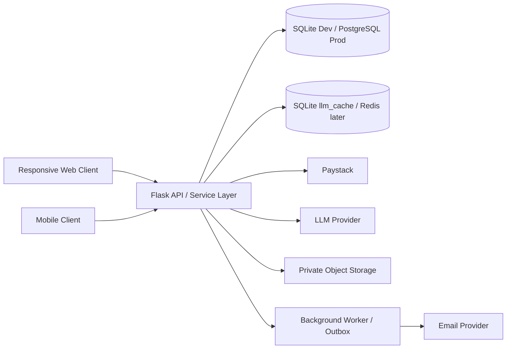

# Career Agency — Web and Mobile Architecture

**Status:** Architecture baseline for implementation  
**Clients:** Responsive web application plus dedicated mobile application  
**Backend:** Python/Flask API during the controlled rebuild; modular service boundaries  
**Visual direction:** Premium enterprise; dark authentication entry screen.

## 1. First-screen rule

The first screen users see at the web root is the **dark Login screen**, not a marketing landing page or dashboard.

- Background: near-black/navy gradient, subtle premium accent, restrained motion.
- Centered login panel on desktop; full-height, safe-area-aware form on mobile.
- Brand mark and Career Agency title at top.
- Email and password fields, show/hide password control, Forgot Password, primary Sign In.
- Secondary Create Account link and legal links.
- Clear validation, loading, disabled and network-error states.
- Unauthenticated navigation to protected routes redirects to Login.
- Successful authentication routes according to the server-verified role.
- A logged-in user opening the root is routed to their role dashboard.
- Do not expose employer/recruiter/admin workspaces before server authorization.

This is the app entry screen. A public marketing website, if later required, must use a separate route/domain and must not replace the auth-first app entry.

## 2. System context

## 3. Backend architecture

Use a modular monolith initially. This keeps deployment manageable while creating clear boundaries.

Suggested modules:
- `app.py`: application factory/entry point and blueprint registration only.
- `config.py`: environment-based settings and startup validation.
- `extensions.py`: database, session, CSRF, rate-limit and logging setup.
- `auth/`: registration, login, verification, reset, session lifecycle.
- `users/`: profiles and account settings.
- `wallet/`: package catalogue, balance, ledger, debit/refund service.
- `payments/`: Paystack initialization, signature validation, verification, webhook idempotency.
- `ai/`: action registry, cache key builder, SQLite cache-first execution, provider adapter, pricing.
- `jobs/`: discovery, saved jobs and application tracking.
- `documents/`: CV storage, extraction, ATS and document versioning.
- `interviews/`: calendar and mock interview orchestration.
- `employer/`, `recruiter/`, `admin/`: role-specific services and blueprints.
- `notifications/`, `support/`, `audit/`: cross-cutting services.
- `migrations/`: ordered schema migrations.
- `tests/`: unit, integration, security and contract tests.

The current repository has a very large legacy `app.py` with overlapping route declarations and a missing `v25_engine` import in the audited tree. Do not replace it blindly. The first integration change must preserve old routes, identify missing dependencies, and add the new API through isolated modules/blueprints. Resolve duplicate route names only after tests and a route inventory establish the intended behaviour.

## 4. Web client

Recommended implementation: React + TypeScript with a shared design system.

### Application shell
- Auth boundary loads `GET /api/v1/auth/me`.
- Role-aware route registry is derived from server identity.
- Desktop: fixed left sidebar, top bar, main content and optional contextual right panel.
- Tablet: collapsible sidebar and responsive content grid.
- Mobile web: compact top bar, single-column content, bottom navigation by role.
- Design tokens, typography, spacing, forms, modal, toast, table, drawer, skeleton, empty and error components are shared.

### Route groups
- `/login`, `/register`, `/forgot-password`, `/reset-password`, `/verify-email`.
- `/app/job-seeker/*`.
- `/app/employer/*`.
- `/app/recruiter/*`.
- `/app/admin/*` (separate guard and elevated session policy).

### State and API handling
- Server state uses a query/cache layer with request cancellation, retry policy and invalidation.
- Form state validates on client for usability and on server for authority.
- Wallet balance refreshes after ledger mutations and payment confirmation.
- Never optimistically show a successful payment or credit debit before server confirmation.
- AI actions show a cost estimate and confirmation before dispatch; display actual charged amount from server response.
- Uploads use progress and server-returned document IDs.
- Error boundaries prevent one screen failure from crashing the entire workspace.

## 5. Mobile client

Recommended: React Native with TypeScript, sharing API contracts, design tokens, validation schemas and domain types with web where practical.

- Secure token storage using platform secure storage; do not use plain AsyncStorage for long-lived secrets.
- Deep links for email verification, password reset and payment return.
- Push notifications only after explicit permission.
- Camera/file picker access only when a user starts an upload and grants permission.
- Offline support for safe read-only cached content and draft editing; no offline wallet debits or payment confirmation.
- Mobile navigation:
  - Job seeker: Home, Jobs, Applications, AI, Profile.
  - Employer: Home, Jobs, Candidates, Messages, Company.
  - Recruiter: Home, Candidates, Pipeline, Messages, Profile.
  - Admin: dedicated protected navigation; avoid exposing admin links to non-admin users.
- Native back navigation must preserve form drafts and return to the previous screen.
- All touch targets should be at least 44×44 points.

## 6. Authentication and role routing

1. App opens to dark login when no valid session exists.
2. Client submits credentials to API.
3. Server verifies password hash, account status, email verification and rate limits.
4. Server issues secure session/refresh credentials.
5. Client calls `/auth/me`; server returns canonical role.
6. Router sends user to the matching workspace.
7. Every API request re-checks permission and record ownership.
8. Session expiry routes to login with a safe return-to path.
9. Logout revokes server session and clears client secure storage.

The UI must not determine access from a locally stored role string.

## 7. AI and credit architecture

- All paid AI requests use one server-side action registry.
- The server resolves base price and approved cache-hit price.
- SQLite `llm_cache` lookup is performed before any debit or LLM provider call.
- Cache keys include tenant/user privacy scope, model and prompt versions, action, locale and canonical input.
- On a hit, debit the approved discounted amount atomically and return the cached response.
- On a miss, debit base amount atomically, call provider outside the DB transaction, store successful response and refund exactly once on failure.
- Do not cache private data across accounts or allow a client to submit an arbitrary cache key.
- AI provider keys are environment/secret-manager values, never browser values or database plaintext.

## 8. Payment architecture

- Client asks API to initialize a package purchase.
- API looks up active package and calculates amount/credits itself.
- API initializes Paystack and stores a pending payment/reference.
- Client opens Paystack checkout.
- Paystack sends webhook to backend.
- Backend validates HMAC signature, independently verifies transaction, checks exact amount/currency/reference, then credits wallet in one idempotent DB transaction.
- Client polls payment status; browser redirect is informational only.
- Replayed webhooks cannot double-credit.

## 9. Environments and deployment

### Local / Termux development
- SQLite database, local file storage, Flask development server.
- Environment variables in an untracked `.env`; `.env.example` contains placeholders only.
- Debug mode only in local development.
- No production payment secret or real customer data in test databases.

### Production
- Managed PostgreSQL with backups and tested restore.
- Redis for rate limits, short-lived distributed coordination and task broker where needed; SQLite cache remains the first lookup source until a deliberate cache migration.
- Object storage with private buckets and signed, short-lived download URLs.
- WSGI server behind HTTPS reverse proxy.
- Background worker for email, job sync, file processing and long-running AI tasks.
- Secret manager for session, Paystack, email and AI provider secrets.
- Error monitoring, structured logs, metrics, uptime alerts and audit retention.
- Automated database backups, restore drills, dependency scanning and security updates.

## 10. Accessibility, responsive and performance targets

- WCAG 2.2 AA as the accessibility target.
- Keyboard navigation and visible focus on web.
- Semantic labels and screen-reader announcements for validation and status.
- Respect reduced-motion preferences.
- Responsive breakpoints around mobile, tablet and desktop; do not hard-code fixed content widths.
- Paginate job, application, ledger and admin lists.
- Lazy-load noncritical modules and images.
- Avoid loading admin bundles in job-seeker routes.
- Keep API payloads bounded and validate file sizes before processing.

## 11. Quality gates

- Unit tests for auth, pricing, cache key, wallet ledger and Paystack signature/verification.
- Integration tests for cache hit/miss, insufficient balance, provider failure/refund, duplicate idempotency key and webhook replay.
- Contract tests for every API response and role.
- End-to-end tests for first login, registration, job workflow, CV workflow, AI confirmation, checkout, webhook credit and logout.
- Mobile tests for secure storage, deep links, navigation, permissions and interrupted network.
- Security review for IDOR, CSRF, XSS, SQL injection, file upload, session fixation, rate limiting, webhook forgery and role escalation.
- No production readiness claim until CI, migrations, test suite, deployment, payment sandbox and independent security review pass.
